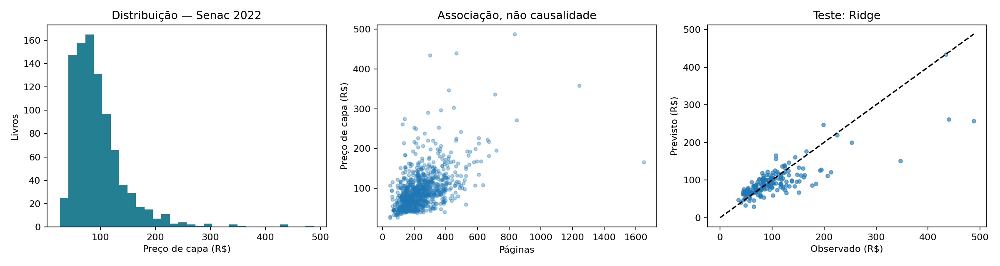

# Resultados — preços de capa do catálogo Senac (janeiro de 2022)

Amostra: 923 livros; treino: 738; teste reservado: 185. Uma linha com colunas inconsistentes foi excluída. Seleção por MAE médio em cinco folds agrupados no treino.

## Validação cruzada no treino

| modelo | mae_cv | desvio_cv |
| --- | --- | --- |
| Ridge | 20.02 | 0.90 |
| Random Forest | 20.20 | 0.76 |
| Mediana | 32.46 | 1.33 |

## Teste reservado

| modelo | mae | rmse | r2 |
| --- | --- | --- | --- |
| Mediana | 36.22 | 64.99 | -0.08 |
| Ridge | 22.60 | 37.46 | 0.64 |

## Interpretação e limites

O erro absoluto médio (MAE) está em reais de janeiro de 2022. O desvio entre folds não é intervalo de confiança. O teste pertence ao mesmo catálogo: não demonstra generalização para outras editoras ou épocas. Títulos normalizados idênticos permanecem na mesma partição; variantes de título e famílias de edições ainda podem escapar do agrupamento. Não houve busca de hiperparâmetros. Correlação e importância preditiva não demonstram causalidade. Zeros em medidas físicas são ausências, preenchidas somente no treino. A Editora 34 não participa do modelo, pois faltam características e o período é diferente.
